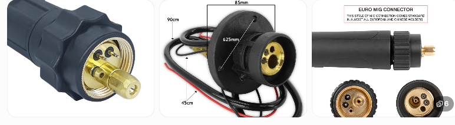
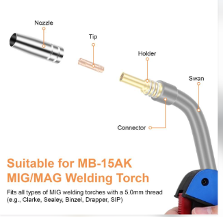
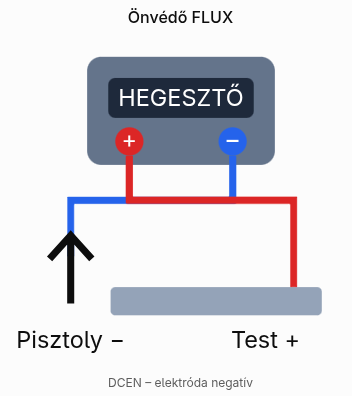
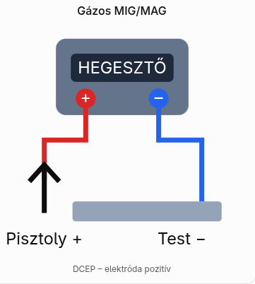

# Hegesztő gép paraméterek

## Gép típus

## Pisztoly típus

Két külön dologról beszélünk:
- EURO-csatlakozó: a MIG/MAG pisztoly és a hegesztőgép közötti csatlakozás szabványszerű kialakítása. Ezen keresztül történik többek között az áram, a huzal és a védőgáz továbbítása.
- MB15 / 15AK: a pisztoly típusa, amely meghatározza, milyen áramátadó csúcs, diffúzor, gázterelő és pisztolynyak illeszkedik hozzá.
Egy MB15 pisztoly lehet EURO-csatlakozós, de ettől még a két jelölés nem ugyanazt jelenti.

### Gép -> pisztoly csatlakozó típus

A MIG/MAG hegesztőpisztoly EURO-csatlakozójának pontos, nemzetközileg használt megnevezése:

EURO Central Connector, más néven Euro Central Adaptor vagy Euro Connector.

A legismertebb változata a Binzel-féle EURO központi csatlakozórendszer, amelyet gyakran így jelölnek:
- Euro Central Connector (ECC) – a pisztoly csatlakozója.
- Euro Central Adaptor – a hegesztőgépen található fogadóegység.
- Euro MIG Torch Connector – gyakori kereskedelmi megnevezés.

A csatlakozó egyetlen egységben biztosítja a hegesztőáram, a huzal, a védőgáz és a pisztolykapcsoló kapcsolatát.

Fontos: az EURO-csatlakozó nem azonos az MB15 pisztolytípussal. Ugyanilyen EURO-csatlakozóval készülhet MB15, MB25 vagy MB36 pisztoly is.

Ha alkatrészt keresel hozzá, a legjobb keresőkifejezés: MIG MAG Euro central connector.

### Nyak típusa

Az MB15 / TW15 a MIG/MAG hegesztőpisztoly típusát, pontosabban a pisztolycsaládját jelöli.

Nem a hegesztőgép típusa, hanem a hozzá csatlakoztatott pisztoly kialakítása.
- MB15 – a Binzel MB 15 AK pisztolycsaládjára utaló típusjelölés.
- TW15 – egy másik gyártói vagy kereskedelmi jelölés a hasonló, 15-ös méretosztályú pisztolyokra.
- 15AK – szintén gyakori megnevezés, különösen az utángyártott alkatrészeknél.

> !WARING: A csúcs mindig olyan furattal kell rendelkezzen, ami a huzal átmérője, mert ezen keresztül kapja az áramot, és ha túl laza, akkor lötyög benne, nem lesz jó a contact, és még meg sem vezeti megfelelően, össze vissza fog hajlani. 

---

# Huzalok 

## Védőgáz nélkül (Flux)

Ez azért fröcsköl, mert a flux, ami védi a varratot szétspriccel hegesztés közben. Védőgáz esetén ez nincs. 

### Polarítás

Általában a pisztoly a negatív, de a huzalon rajta kell legyen. 
* DCEN: pisztoly a negatív. 

### Típusok

Figyelni kell a méretre is, az 5 kg egy jó ár érték arány. 

* E71T-11 -> védőgáz nélküli, porbeles, huzal több mentes, vagyis többször át lehet menni a varraton
  * PL: https://eur.vevor.com/mig-welding-wire-c_12223/vevor-flux-core-mig-welding-wire-e71t-11-0-9mm-4-5kg-gasless-mild-steel-welding-wire-with-low-spatter-for-all-position-arc-welding-self-shielded-for-outdoor-use-p_010902005620
* E71T-GS ->  védőgáz nélküli, porbeles, huzal, egy menetes, vagyis csak egyszer lehet átmenni egy varaton 
  * Pl: https://www.hegesztogepbolt.hu/Hegesztes/MIG-MAG-hegesztes/Hegeszto-huzalok/Porbeles-hegeszto-huzal-09mm-5kg-portolteses-huzal-vedogaz-nelkuli-hegeszteshez

## Védőgázhoz 

TODO

### Polarítás

Általában a pisztoly a pozitív:
* DCEP: pisztoly pozitív

